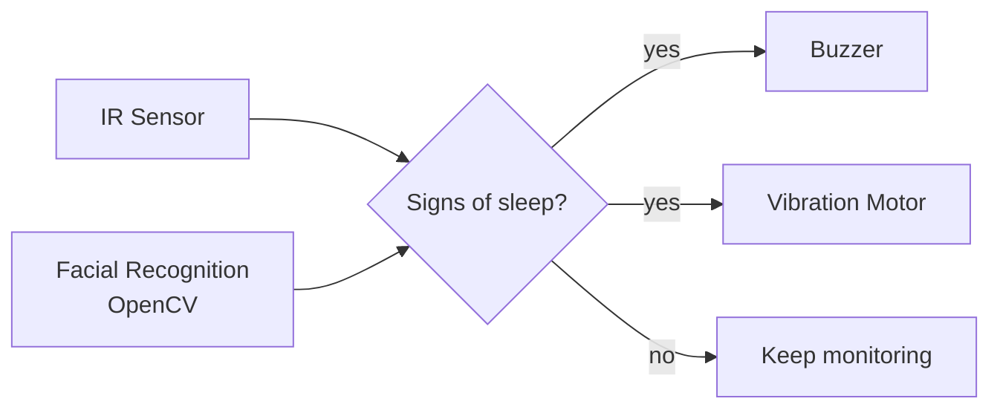
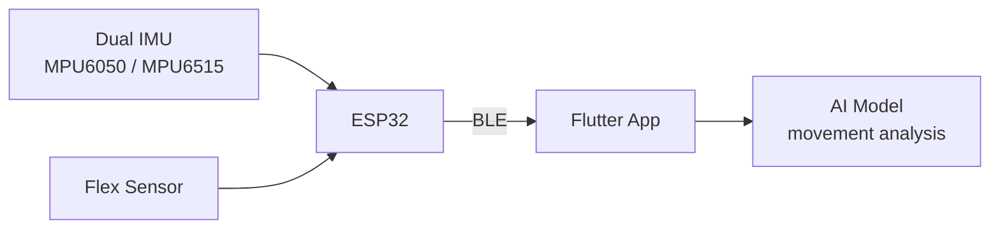

<div align="center">


[](https://git.io/typing-svg)


</div>


## 🖥️ `whoami`

```bash
$ whoami
harsh-gupta  # B.Tech ECE student, KIET Ghaziabad (2024 – 2028)

$ cat interests.txt
software · web · dsa · ai/ml · embedded · iot · vlsi · robotics · uav · dsp

$ cat status.txt
🌱 learning   →  web dev: HTML → CSS → JavaScript → React → Backend
🔧 tinkering  →  Arduino · ESP32 · ESP8266 · sensors · drone hardware
🧠 exploring  →  machine learning with the Python data stack

$ echo $HONESTY
I'm a student. Most of this is "learning in public", not "years of experience".
```


## 🧬 The Full Spectrum

<table align="center">
<tr>
<td align="center" width="25%">

### 💻<br/>Software
C · C++ · Python · Java<br/>DSA · Web basics

</td>
<td align="center" width="25%">

### 🔌<br/>Embedded
Arduino · ESP32 · ESP8266<br/>PWM · UART · I2C · SPI

</td>
<td align="center" width="25%">

### 🤖<br/>AI / ML
NumPy · Pandas<br/>Matplotlib · Seaborn

</td>
<td align="center" width="25%">

### 🚁<br/>UAV / Robotics
Pixhawk · Mission Planner<br/>VTOL · RC · ELRS

</td>
</tr>
</table>


## 🎓 Education

| | |
|---|---|
| 🏛️ **KIET Deemed to be University**, Ghaziabad, Uttar Pradesh | B.Tech, Electronics & Communication · *Sep 2024 – May 2028* |
| 🏫 **RVS International School** (ICSE) | Class 12 (PCM) · Class 10 |

**Coursework:** Machine Learning · Data Structures · Operating Systems · Computer Networks · VLSI · Data Engineering (AWS)


## 💻 Languages

<p>
  
</p>

Plus **Embedded C** for microcontrollers, **MATLAB** for numerical work, and **Verilog / SystemVerilog / VHDL** concepts for digital design.


## 🌱 Learning Journey: Web Development

I'm starting web development from the basics and climbing one step at a time.

```text
  ┌──────┐   ┌──────┐   ┌────────────┐   ┌─────────┐   ┌─────────┐   ┌─────────┐
  │ HTML │ ─▶│ CSS  │ ─▶│ JavaScript │ ─▶│  React  │ ─▶│ Node.js │ ─▶│ MongoDB │
  └──────┘   └──────┘   └────────────┘   └─────────┘   └─────────┘   └─────────┘
    Basic      Basic        Basic          Learning      Learning      Learning
```

<p>
  
</p>


## ⭐ Featured Projects

### 😴 NapAlert: Smart Drowsiness Detection System

> A real-time drowsiness detection system that alerts the driver before they fall asleep.



- Detects signs of sleep using **IR sensors** and **facial recognition**
- Alerts the driver with a **buzzer** and **vibration motor**


I've also explored a wearable concept of NapAlert, built around head-tilt detection with a physical alert, in a clip or headband form factor.

---

### 🦴 Osteoarthritis Monitoring System

> A wearable sensing concept for tracking joint movement, developed for Smart India Hackathon.



- **Dual-IMU** wearable sensing with a **flex sensor**, read by an **ESP32**
- Data sent over **BLE** to a **Flutter** mobile app
- An **AI model** analyzes the movement data


This is a monitoring and research concept. It is not a diagnostic or medical device.

---

### ❌⭕ Tic-Tac-Toe AI

> A console-based game with an unbeatable computer opponent.

```text
              Minimax: the AI assumes you play perfectly

                      [ current board ]            ← AI picks max
                       /      |      \
                   [move A] [move B] [move C]      ← you pick min
                    / \       / \       / \
                  +1  0     -1  0     +1  +1       ← depth-scored outcomes
```

- **Minimax** with recursion and depth-based scoring for optimal decisions
- Modular board display, move validation and game-state evaluation


**Future scope:** Tkinter/Pygame GUI · difficulty levels · alpha-beta pruning

---

### ✅ To-Do List Manager

> A command-line task manager built with Python.

- Full **CRUD**: add, view, update and delete tasks
- Tasks carry a **date and time**, and the **weekday is detected automatically**
- Tasks display in **chronological order**


## 🧰 Deep Dives

<details>
<summary><b>🔌 Embedded & Hardware</b></summary>
<br/>

<p>
  
  
  
</p>

| Area | What I've worked with |
|---|---|
| 🧠 **Microcontrollers** | Arduino Uno · ESP32 · ESP8266 |
| 📡 **Protocols** | PWM · UART · I2C · SPI *(basic)* |
| 🎛️ **Interfacing** | Sensors & actuators |
| 🧪 **Lab & prototyping** | Digital Trainer Kit · Tinkercad |
| 🌐 **Concepts** | IoT · embedded systems · wearable systems |

</details>

<details>
<summary><b>🚁 UAV / Robotics</b></summary>
<br/>

Drones are where my software and electronics interests meet. I'm learning through study and hands-on exposure.

| Domain | Topics |
|---|---|
| ✈️ **Airframes** | UAV fundamentals · quadrotor · QuadPlane · VTOL |
| 🎮 **Flight control** | Flight controllers · Pixhawk basics · Mission Planner |
| 📶 **Radio & navigation** | RC systems · ELRS basics · GPS & compass integration |
| 🔋 **Power** | Drone power systems · Li-ion / LiPo battery basics |

</details>

<details>
<summary><b>🤖 AI / ML & Data (exploring)</b></summary>
<br/>

I'm early on this path and building the foundation.

<p>
  
  
</p>

- Python data stack: NumPy, Pandas, Matplotlib, Seaborn
- Machine Learning fundamentals through coursework
- Data Engineering (AWS) coursework

</details>

<details>
<summary><b>🛠️ Tools & Software</b></summary>
<br/>

<p>
  
</p>

<p>
  
  
  
  
</p>

Cadence EDA tools for digital system design.

</details>


## 📊 GitHub Stats

<div align="center">


</div>

## 🐍 Contribution Snake

<div align="center">

<picture>
  <source media="(prefers-color-scheme: dark)" srcset="https://raw.githubusercontent.com/guptaharsh18/guptaharsh18/output/github-snake-dark.svg"/>
  
</picture>

</div>


## 🧭 Roadmap

- [ ] Get comfortable building full web projects with React and Node.js
- [ ] Add a GUI and alpha-beta pruning to Tic-Tac-Toe AI
- [ ] Go deeper on ML, from fundamentals to working models
- [ ] Take on more complete embedded and UAV builds

<div align="center">

*Curious about the intersection of code and circuits.*

[](https://github.com/guptaharsh18)


</div>
